

  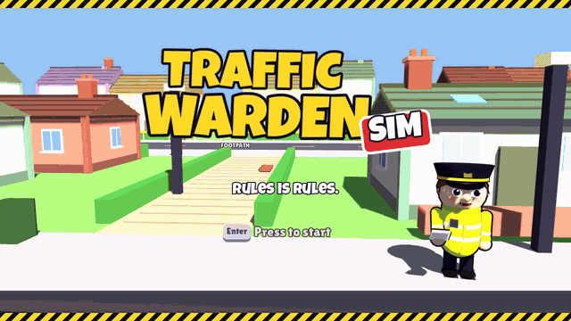

  <a href="docs/promo.mp4"><b>▶ Watch the trailer with sound (MP4)</b></a>

  

<h1 align="center">TRAFFIC WARDEN SIM</h1>

<b>Ticket. Dodge. Punch. Repeat.</b>

  <a href="https://github.com/colemanuk82/traffic-warden-simulator/releases/latest"><b>Download for Windows</b></a>
  &nbsp;·&nbsp;
  <a href="https://paypal.me/colemanuk82">Buy the dev a cuppa</a>

<table>
  <tr>
    <td>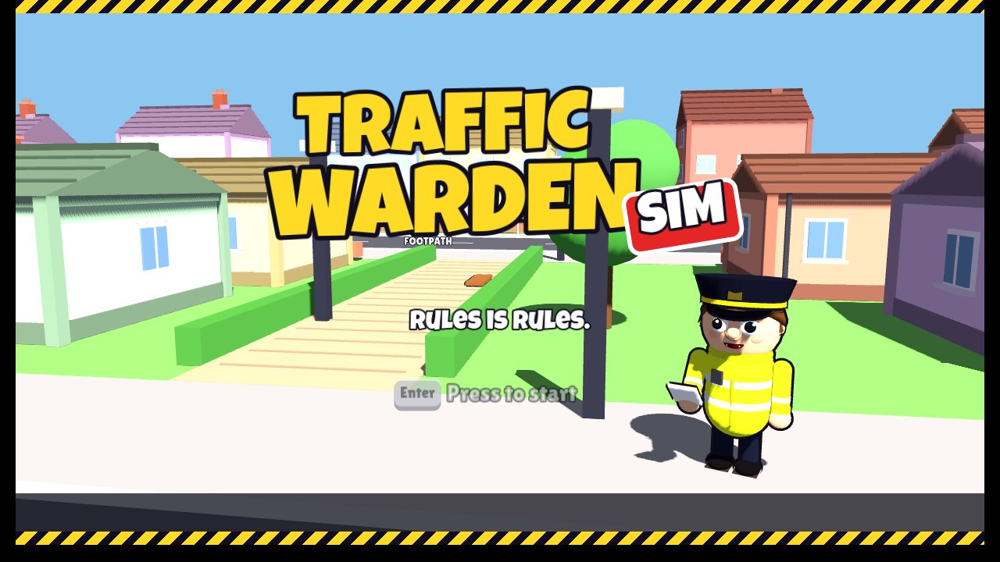</td>
    <td>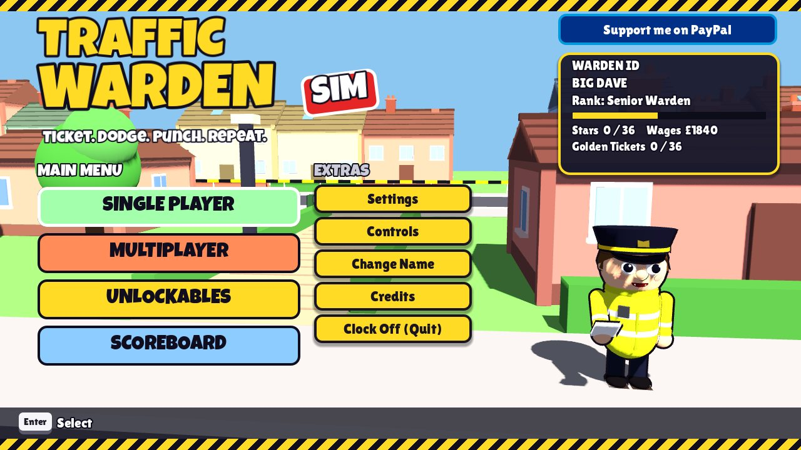</td>
  </tr>
  <tr>
    <td align="center">The title screen. Rules is rules.</td>
    <td align="center">The main menu: Single Player, Multiplayer, Unlockables and Scoreboard.</td>
  </tr>
</table>

Somebody has to do it. Somebody has to stand in the drizzle with a ticket machine and a high-vis vest while
Gary from number 42 leaves his hatchback on the double yellows "for literally one minute, mate".

That somebody is **you**.

Traffic Warden Sim is a top-down cartoon game about the most hated job in Britain. Prowl a dozen streets,
spot the dodgy parkers, write tickets before the drivers come back, and leg it when they do. Climb from
lowly Trainee Warden to **Chief Parking Enforcer**, spend your wages on Turbo Shoes and a wet fish, and take
on the Lord Mayor's limo. Then do it all again in the snow.

## Download and play

1. Grab **TrafficWardenSim-1.3.0-setup.exe** from the [latest release](https://github.com/colemanuk82/traffic-warden-simulator/releases/latest).
2. Run it. You get a Start Menu entry, a desktop icon (if you want one) and a proper uninstaller.
3. Sign on for your first shift.

Don't fancy installing? Get the **portable zip** from the same page, unzip it anywhere, and double-click
`TrafficWardenSim.exe`. No Godot, no faff, nothing else needed.

Windows 10 or 11, 64-bit, and any graphics card from the last ten years or so. Windows might give you a
blue "Windows protected your PC" box because the game isn't signed by a big company. Click **More info**
then **Run anyway**. We promise it only bites drivers.

### On an Android phone

1. On your phone, open the [latest release](https://github.com/colemanuk82/traffic-warden-simulator/releases/latest)
   and tap **TrafficWardenSim-1.3.0.apk** to download it.
2. Open the download. Android will ask to let your browser (or Files app) **install unknown apps**: allow it.
3. Tap **Install**, then **Open**. Play Protect may say it doesn't recognise the app: tap **More details**,
   then **Install anyway**.

Android 5 or newer with OpenGL ES 3.0, which covers pretty much any phone from the last eight years.
Turn the phone sideways. Your left thumb drives the warden (put it down anywhere on the left half), and the
big buttons on the right do the rest. A Bluetooth controller works too.

### Staying up to date

The game checks for a new version when it starts. If there is one, a green **UPDATE AVAILABLE** button
appears on the main menu and takes you straight to the right download (the installer on Windows, the APK on
Android). It needs the internet for a second and keeps quiet if you're offline. Turn it off in
**Settings > Check for updates**.

## What's in the van

- **13 streets to patrol**: leafy suburbs, **School Patrol** (zig-zags, lollipop ladies and the school run), a seaside prom, a neon city in the rain, posh avenues, a
  supermarket car park, a multi-storey, hills so steep you'll need a sit down, plus **Spooky Hollow** for Halloween
  and **Christmas Eve** in the town square.
- **The ticket needle**: stop it in the green for a PERFECT write. Miss and you'll be fumbling while the
  driver jogs back with a coffee and a grudge.
- **Drivers with excuses**: two dozen voiced reasons why it's not their fault. "I was only here for a minute."
  "Where else am I meant to park?" You've heard them all. Now hear them again.
- **Drivers with opinions**: nearly thirty cheeky, family-friendly insults, shouted by men and women.
  "You absolute plonker!" "Bog off, you lemon!" "Robocop on a budget!"
- **Self defence**: drivers chase you. You can punch them. They go flying and see stars. It's that kind of game.
  Punches aim themselves at the nearest driver and you lunge in to land them. A yellow ring shows who you'd
  hit, and it turns green for a **PERFECT PUNCH** (extra points, extra knock-back, a lovely crunch).
- **RAMPAGE MODE**: floor three drivers in a row and you get a baseball bat for 15 seconds. Your eyes glow red,
  the screen turns red and drippy, the heavy metal kicks in, and you can knock drivers out cold and smash cars
  until they explode.
- **A death metal soundtrack**, growled lyrics and all ("TICKET OF DOOM!"), plus thrash, doom, groove,
  black metal, metalcore, nu-metal, hardcore punk, grunge, stoner and glam rock. Prefer the old tunes? Pick
  **Classic** in Settings, or try any track in the Jukebox.
- **Boss drivers**: the Lord Mayor and his bodyguards, White Van Man (who moves on every few seconds) and a
  getaway car that bolts if it hears you running.
- **Weather**: rain, storms, snow, blizzards, fog and wind. Cars aim for puddles to soak you on purpose.
- **Gadgets and gear**: wheel clamps, a tow truck, a camera van, and a Depot full of upgrades and weapons,
  from a rolled-up newspaper to a traffic cone.
- **Wardrobe**: hats, vests, caps, specs and haircuts. Look the part while being hated.
- **Hecklers**: Tipsy Terry, Dodgy Dave and Stag Do Steve, plus passing cars yelling "get a proper job!".
  Blow your whistle to shoo them.
- **Pigeons, cats, dog walkers, runaway trolleys, ice cream vans, carol singers, trick-or-treaters,
  and Santa parking his sleigh on the yellows.** Ticket it. Then run.
- **Two player split-screen**: team up in Co-op or settle it once and for all in a Ticket Race.
- **Endless mode, daily and weekly challenges, Golden Tickets, top-5 high score boards and medals.**
- **Full Xbox controller support**, menus and all. Plug a pad in whenever you like.

## Screenshots

<table>
  <tr>
    <td>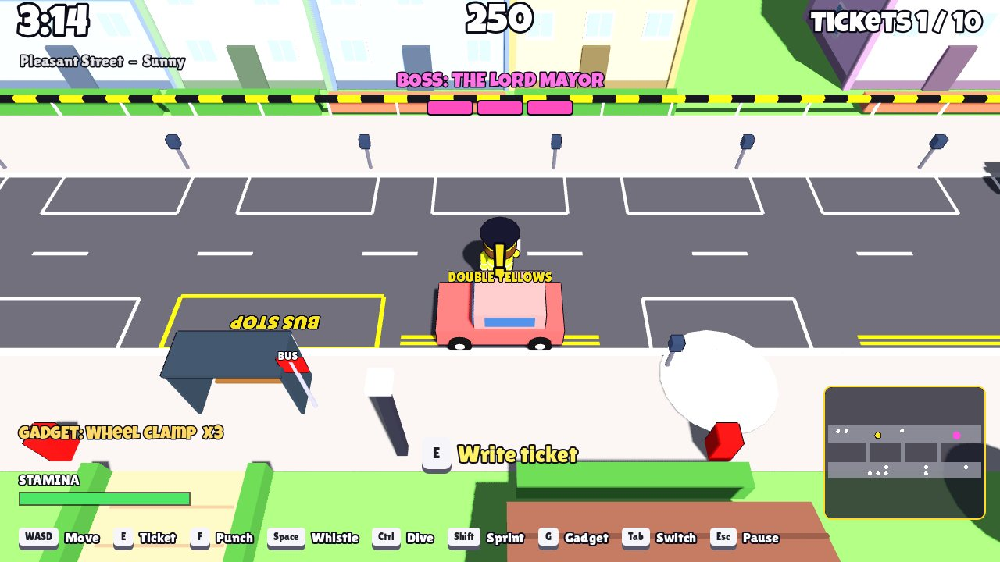</td>
    <td>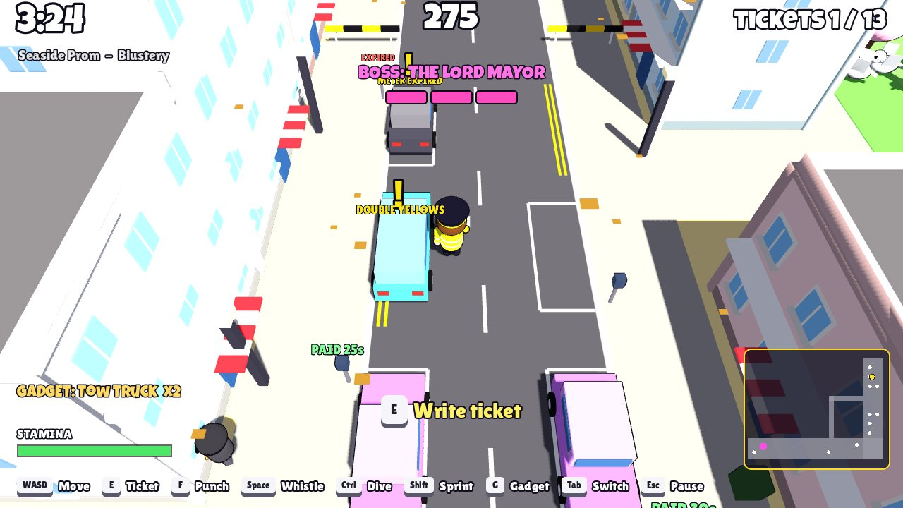</td>
  </tr>
  <tr>
    <td align="center">Pleasant Street. Your first beat. Lovely, isn't it.</td>
    <td align="center">Seaside Prom. Lovely day for a ticket.</td>
  </tr>
  <tr>
    <td>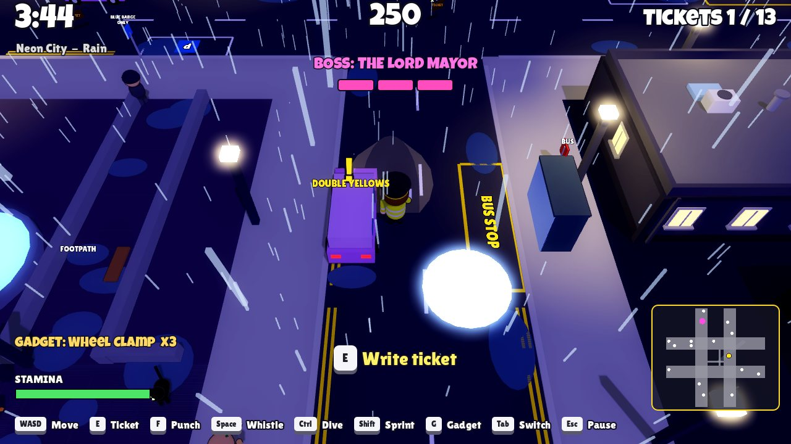</td>
    <td>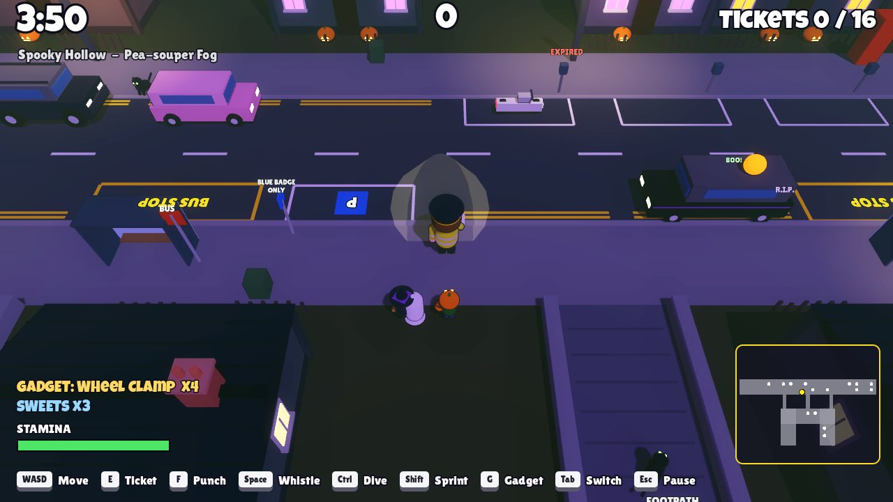</td>
  </tr>
  <tr>
    <td align="center">Neon City. It's always raining in Neon City.</td>
    <td align="center">Spooky Hollow. Keep some sweets handy.</td>
  </tr>
  <tr>
    <td>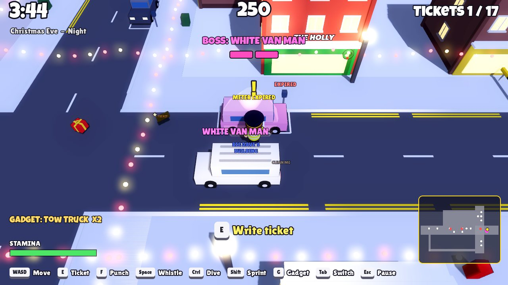</td>
    <td>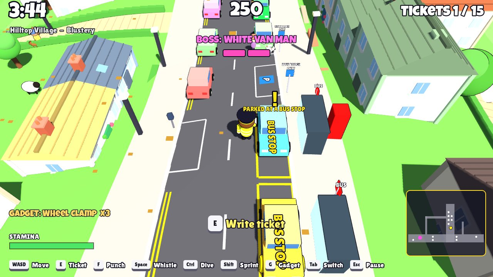</td>
  </tr>
  <tr>
    <td align="center">Christmas Eve. Even Santa isn't above the law.</td>
    <td align="center">Hilltop Village. Sheep, hay bales and a bus in the bus stop.</td>
  </tr>
  <tr>
    <td>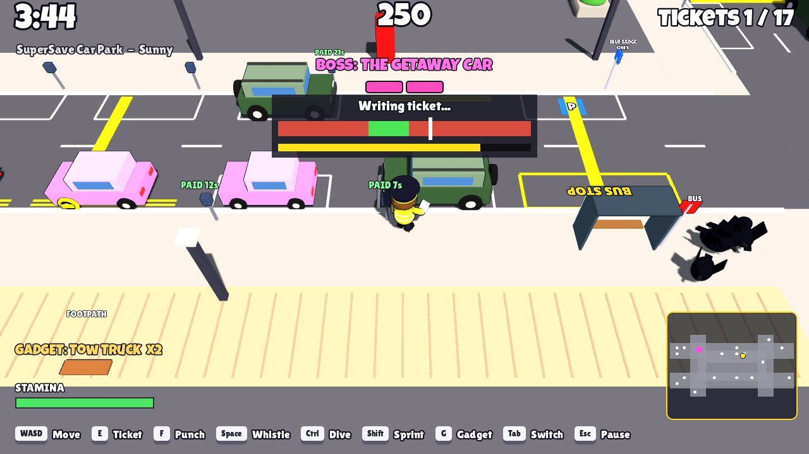</td>
    <td>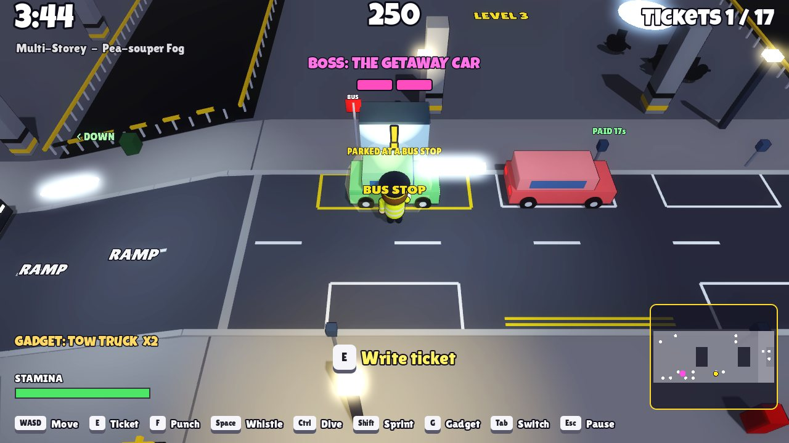</td>
  </tr>
  <tr>
    <td align="center">SuperSave Car Park. Stop the needle in the green.</td>
    <td align="center">The Multi-Storey. Ramps, fog and nowhere to hide.</td>
  </tr>
  <tr>
    <td>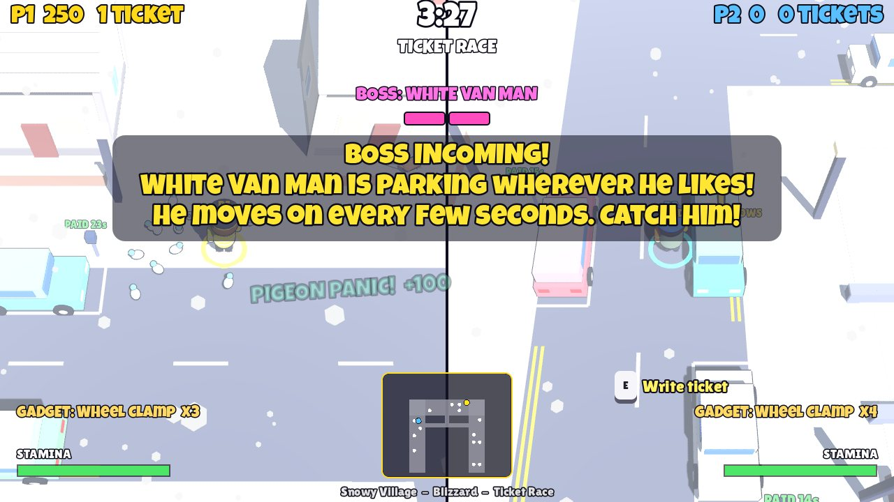</td>
    <td>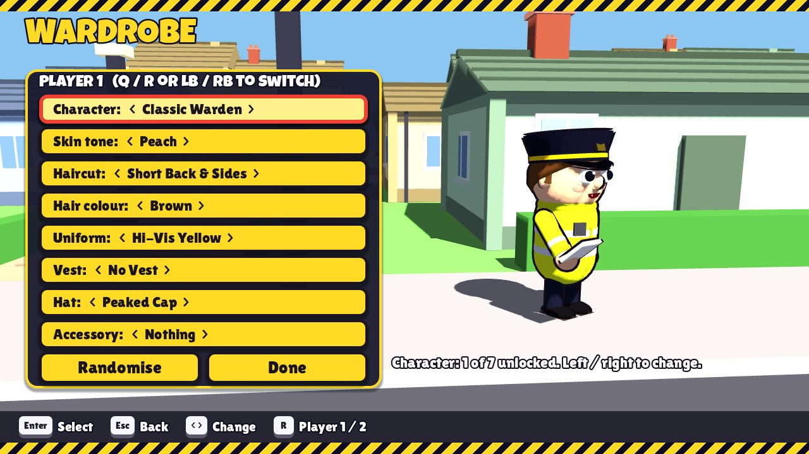</td>
  </tr>
  <tr>
    <td align="center">Ticket Race. Friendships have ended over less.</td>
    <td align="center">The Wardrobe. Dress for the job you want.</td>
  </tr>
</table>

## Controls
| Action | Keyboard / mouse | Xbox controller |
|---|---|---|
| Move | WASD or arrows | Left stick / d-pad |
| Sprint (uses stamina) | Shift | LB or LT |
| Ticket: start, then stop the needle | E or left click | A |
| Punch | F or right click | Y or RT |
| Whistle (freezes nearby drivers 2s) | Space | X |
| Dive (dodge, cancels a ticket) | Ctrl | B |
| Use gadget (clamp, tow truck, camera van) | G | RB |
| Switch gadget | Tab | View (Back) |
| Pause | Esc or P | Menu (Start) |
| Menus | Arrows / WASD, Enter, Esc | D-pad / stick, A, B |

On-screen prompts switch between keyboard keys and Xbox buttons depending on what you touched last.

**On a phone:** put your left thumb anywhere on the left half of the screen and a stick appears under it.
Push it past the ring to run (or hold **RUN**). The right side has **TICKET**, **PUNCH**, **WHISTLE**,
**DIVE**, plus **GADGET** and **SWAP** once you've earned a gadget. The **II** button at the top pauses.
Menus are tap to pick, and **BACK** (or the phone's back button) goes back.

**Two players (split-screen):** with two pads, one each. With one pad, player 1 uses the keyboard and player 2
the pad. With no pads, player 2 uses the arrow keys and numpad (1 ticket, 2 punch, 3 whistle, 0 sprint,
. dive, 4 / 5 gadget).

## The menu

- **Single Player**: Start Shift, Training Day, Special Events, Endless Mode, Challenges and your Career.
- **Multiplayer**: Co-op Shift, Ticket Race, Player 2's wardrobe and name.
- **Unlockables**: Wardrobe, The Depot (shop), Golden Tickets, All Unlockables and the Jukebox.
- **Scoreboard**: High Scores, Stars and Medals, and Your Stats (tickets written, drivers punched, times splashed...).
- **Extras**: Settings, Controls, Change Name, Credits and Clock Off.

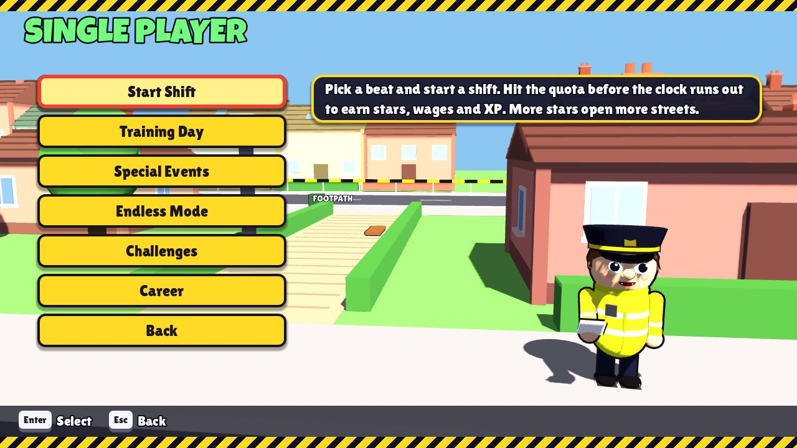

## The rules of the road

- Illegal cars flash a yellow **!** when you're close: parked on **double yellows**, in a bay with an
  **EXPIRED** meter, in a bus stop, or in a disabled bay with no blue badge.
- Walk up, press Ticket, stop the needle. A ticket is 100 points; chain them for combos up to x3.
- Ticket a legal car and it's -150 and a stern word from the council.
- Get caught by an angry driver: -50 and three seconds seeing stars. Dive past them for a close-call bonus.
- Punch a driver who's chasing you: +50 for self defence, +25 more for a perfect punch when the ring is green.
  Press a bit early and the punch waits for them. Punch a car: nothing happens, but you'll feel better.
- Hit the quota before the clock runs out to earn stars. Stars unlock new streets.

## Support the game

Traffic Warden Sim is free. If it made you laugh, or made you feel a tiny bit sorry for the next warden you
see, you can buy the developer a cuppa:

**[paypal.me/colemanuk82](https://paypal.me/colemanuk82)**

There's a button for it on the main menu too. No pressure. Well, a little bit of pressure. We do write tickets.

## For the nerds

Made in **Godot 4.3** with GDScript. Everything (streets, cars, people, animals) is built from code at
runtime; the music, sound effects and voices were generated for the game.

**Play from source:** clone the repo and double-click `Create Desktop Shortcut.bat` once, then the new desktop
icon. It finds Godot 4.3+ on your PC or downloads a portable copy into `godot/` on the first run. Or open the
folder in the Godot 4.3 editor and press F5.

**Build the release:** `tools/build_release.sh 1.0.0` (needs Godot 4.3 as `$GODOT` with the 4.3 export
templates, plus NSIS's `makensis` and `zip`). It exports `TrafficWardenSim.exe` with everything packed inside
(audio and fonts are packed as raw files because the game loads them at runtime), then makes the portable zip
and the installer from `installer/installer.nsi`. Output lands in `build/release/`.

**Build for Android:** `tools/build_android.sh 1.3.0` makes a signed APK in `build/release/`. It needs the
4.3 export templates and an Android SDK path in Godot's editor settings with `apksigner` (the Ubuntu `apksigner`
package is enough). The signing key is never in the repo: pass it with `ANDROID_KEYSTORE`, `ANDROID_KEY_ALIAS`
and `ANDROID_KEY_PASSWORD`, and keep using the same one, because Android only installs updates signed with it.
Phones use the Compatibility (OpenGL ES 3) renderer and draw the game at 720p on Low and Medium graphics.
For a desktop test of the touch controls, run the game with `-- --touch`.

Your career, wages and wardrobe save to `%APPDATA%\Godot\app_userdata\Traffic Warden Sim\save.cfg`.

### The beats
Unlock each level with stars (1 star = quota met, 2 and 3 stars for high scores).

| Level | Shape | Look | Stars to unlock |
|---|---|---|---|
| Pleasant Street | One long straight road | Sunny suburb | 0 |
| Market Crossroads | Plus-shaped junction | Town centre shops and market stalls | 1 |
| Seaside Prom | L-shape up the hill | Beach, sea, pier and beach huts | 3 |
| School Patrol | Long street with a side road | Parkside Primary, zig-zags, zebra crossings, lollipop ladies | 4 |
| Snowy Village | U-shape round the green | Snow, cottages, Christmas tree | 6 |
| Neon City | Grid of four roads | Night time, neon signs, street lights | 9 |
| Posh Avenue | Zig-zag | Golden hour mansions and fountains | 12 |
| SuperSave Car Park | Supermarket car park | Trolley bays, speed bumps, the store | 14 |
| Multi-Storey | Three split-level decks and the roof, joined by ramps | Concrete, pillars, strip lights, roof lamps | 17 |
| Spooky Hollow | Long street with a lane looping round a graveyard | Halloween night, haunted houses, pumpkins | 6 |
| Christmas Eve | Crossroads by the town square | Snow, fairy lights, giant tree, Santa's grotto | 9 |
| Hilltop Village | Winding road over rolling hills | Stone cottages, sheep, hay bales | 26 |
| Steep Street | Two roads up a steep hill and a cross street | Pastel terraces | 29 |

Each shift rolls the weather from that level's list: sunny, rain (slippery), thunderstorm (slippery, lightning),
snow (slower), blizzard, fog or blustery wind.

### Climbing the ranks
| Rank | XP | Unlocks |
|---|---|---|
| Trainee Warden | 0 | |
| Warden | 1,500 | Wheel clamp (3 per shift): the car can't leave, ticket it at leisure |
| Senior Warden | 5,000 | Tow truck (1 per shift): big points, the car is gone |
| Sergeant Warden | 10,000 | Camera van (1 per shift): tickets offenders nearby by itself |
| Inspector | 18,000 | +1 use of every gadget, inspector hat |
| Chief Parking Enforcer | 30,000 | Chief uniform |

**The Depot** sells upgrades (Turbo Shoes, Bigger Ticket Book, Megaphone, Tea Flask, Gadget Belt, Council Bike)
and weapons (Rolled-up Newspaper, Ticket Printer, Walkie-Talkie, Brolly, Wet Fish, Traffic Cone). Each weapon
has its own reach and knock-back; the printer fines drivers who chase you, the walkie-talkie calls backup,
and the brolly keeps you dry from puddle splashes.

### Audio
Music and sound effects were generated for this game by `tools/gen_audio.py`, `tools/gen_audio_extra.py`
(rock and metal tracks, car stereos, dog barks), `tools/gen_audio_metal.py` (the death metal soundtrack with
growled vocals, and ten more rock and metal styles) and `tools/gen_animals.py` (cats and garden birds),
synthesised with numpy/scipy. "Here Comes the Bride" (Wagner, 1850) and "Jingle Bells" (Pierpont, 1857)
are public domain melodies.

Every voice line (drivers, hecklers, the announcer, kids, Santa, bosses) comes from `tools/gen_voices.py`,
which reads the scripts with the Kokoro-82M neural text-to-speech model (Apache License 2.0) offline, using
a cast of British men's and women's voices. Takes 0 and 1 of each line are men, takes 2 and 3 are women, so
women drivers shout in a woman's voice. Re-run the scripts to regenerate everything.

### Tuning
Level quotas, timers, star scores, weather lists and hills (`terrain`) are in `scripts/levels.gd`; the hill
shapes are in `scripts/terrain.gd` and the houses, shops and parks in `scripts/scenery.gd`. Scoring is at the top of
`scripts/main.gd`; movement in `scripts/warden.gd`; cars in `scripts/car.gd`; drivers in `scripts/driver.gd`;
unlock requirements in `scripts/catalogue.gd`; ranks, gadgets, upgrades, weapons, events and bosses in
`scripts/career.gd`; challenges in `scripts/challenges.gd`; birds and cats in `scripts/wildlife.gd`.

Pacing lives in `scripts/main.gd` (`_features`, `QUIET_START`, `EVENT_GAP`): nothing big happens in the first
30 seconds of a shift, big moments are at least 40 seconds apart, and the first career levels add one thing
at a time (Pleasant Street is just cars, drivers and the needle; Market Crossroads adds pigeons and full
heckling; Seaside Prom adds trolleys, the ice cream van and bosses; storms start at Snowy Village).

### Credits
- Fonts: Luckiest Guy by Astigmatic (Apache License 2.0) and Lilita One by Juan Montoreano (SIL Open Font License 1.1). Licence files are in `fonts/`.
- Voices: Kokoro-82M by hexgrad (Apache License 2.0), run offline to record the lines.
- Engine: Godot Engine (MIT licence). The full credits, including Godot's licence text, are on the in-game Credits screen.
- Everything else (code, models built from primitives, audio) was made for this project.
